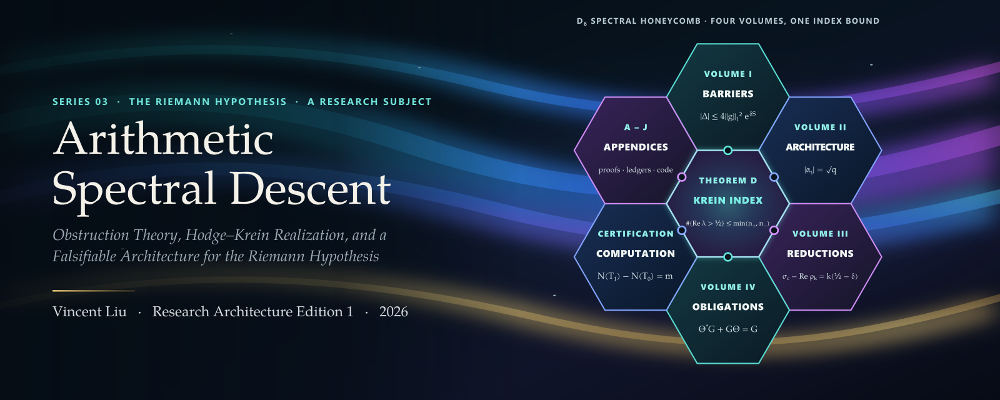
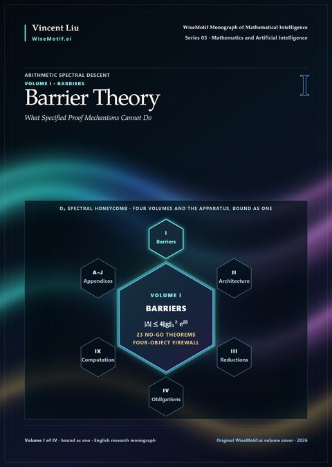
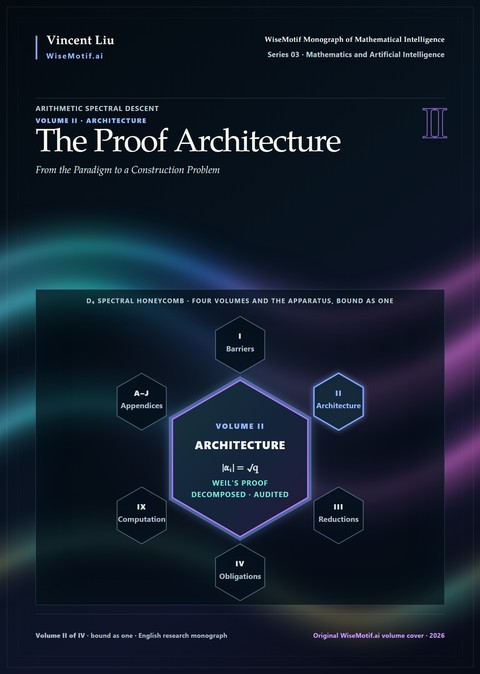
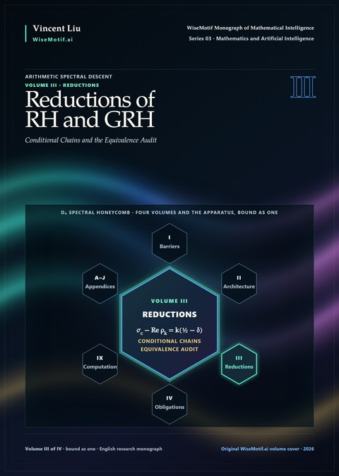
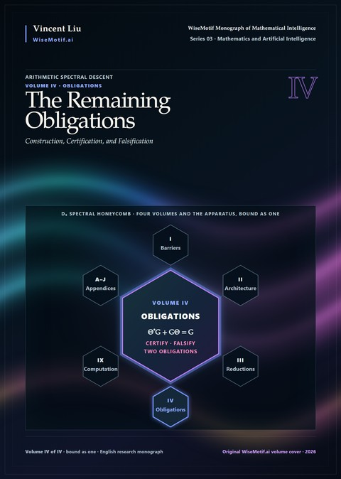
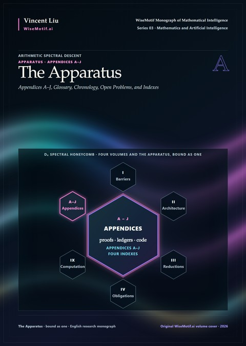
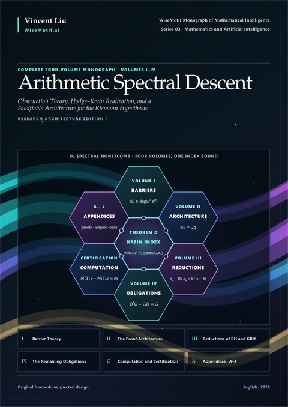

  

  
  
  
  
  
  
  
  

  <b><a href="https://github.com/AlienMuse/arithmetic-spectral-descent/releases/download/v1.0.0/Arithmetic-Spectral-Descent-v1.0.0-Preview.pdf">阅读预览版</a></b>（198 页，74.4 MB）·
  <a href="#下载">下载</a> ·
  <a href="#四卷">四卷</a> ·
  <a href="#引用">引用</a> ·
  <a href="VERIFY.md">校验</a> ·
  <a href="README.md">English</a>

 

# Arithmetic Spectral Descent

Vincent Liu · Research Architecture Edition 1 · 2026 · [English](README.md)

> *难题不在原地强攻；而是在它周围建起理论，直到问题变得自然而自行化解。*
>  — Series Note

《Arithmetic Spectral Descent — Obstruction Theory, Hodge–Krein Realization, and a Falsifiable Architecture for the
Riemann Hypothesis》是一部四卷合一的专著（正文为英文），共 1,549 页。它是 WiseMotif Monograph of Mathematical
Intelligence 的第三部著作，属于 Grothendieckian Programme，但自成独立体系：它是该 Programme 的研究课题之一——
在一个问题上把 Programme 的方法，即递归式数学发现（recursive mathematical discovery），完整地走一遍：提出结构、
检验结构、把经受住检验的部分抽象出来，再在新的层次上重新提出问题，正如 Grothendieck 的"上涨的海"（rising sea）。

所选的问题是黎曼猜想。本书追问：**局部算术能否下降（descend）为一个谱对象，使 zeta 函数的零点成为它的谱，
并由它控制零点的位置？**

**黎曼猜想仍未解决。本书不声称证明了它，也不声称证明了广义黎曼猜想或任何等价命题。** 本书记录的是：一个指向该猜想的
研究纲领，纲领所受的检验，其中失败的部分，由这些失败得到的定理，以及在每一处失败都被说明之后仍然剩下的构造问题。

<table>
  <tr>
    <td align="center"><b>4</b> 卷，合为一册</td>
    <td align="center"><b>10 · 60</b> 部 · 章</td>
    <td align="center"><b>1,549</b> 页</td>
    <td align="center"><b>23</b> 有明确适用范围的 no-go 定理</td>
    <td align="center"><b>1</b> 条件定理 AHK-1–3 ⟹ RH</td>
    <td align="center"><b>2</b> 项待完成的义务 10 项证伪检验</td>
    <td align="center"><b>102 · 340</b> 矢量图 · 参考文献</td>
  </tr>
</table>

## 核心思想：要指标，不要正定性

几乎每一种用来定位零点的自然机制，要么所用的信息无法把 ζ 与零点不在临界线上的函数区分开，要么在某一步恰好丢掉了
临界线上所需要的那部分信息。一个证明必须从第一步到最后一步都保住这部分信息。**本书首先是一项研究：信息究竟在哪里丢失。**

书名描述的正是本书所审视的那条路径。*Spectral*（谱）：从 Hilbert 与 Pólya 起的期望——零点是某个算子的谱。
*Arithmetic*（算术）：这个算子必须来自 ℤ 的算术，而不是在已知零点之后再写出来。*Descent*（下降）：由局部到整体——
各处的局部数据能否下降为同一个算术对象，以零点为其谱，并带有一个控制谱的位置的形式。

本书唯一的实质性选择，是**用指标条件取代正定性条件**。正定性证明得太多（正定的极化本身就已迫使零点落在临界线上并给出正规性），
它与极点不相容，而且它带有余量，问题本身却没有余量：Rodgers 与 Tao 证明了 Λ ≥ 0，所以黎曼猜想就是等式 Λ = 0。
指标是整数，不可能"差不多对"。

| 方法 | 本书所做的事 |
|---|---|
| **划界** | 在提出任何构造之前，证明指定的机制在哪里丢失了临界线上所需的信息 |
| **检验** | 每一种机制都要在由四个已发表反例模型构成的"防火墙"上运行：Davenport–Heilbronn、Beurling、Selberg、Epstein |
| **分解** | 把 Weil 在函数域上的证明拆成它实际用到的输入，使每一项都能在 ℤ 上分别寻找 |
| **审计** | 衡量球谱（sphere spectrum）、分圆同调与 prismatic 上同调提供了什么、没有提供什么 |
| **归约** | 证明由指标为一的 Hodge–Krein 实现推出黎曼猜想的条件链 |
| **认证** | 把经过认证的有限计算与渐近命题严格分开；公开全部脚本与数据 |
| **提出** | 把剩下的两项义务表述得足够精确，使之可以被攻克、被否定或被证伪 |

## 四卷

每一卷都围绕一个问题，并以读者可以拿走、可以使用的东西作结。四卷与附录合为一册。下面每张封面都把该卷置于
D₆ 谱蜂巢的中心，所附公式即该卷在全书封面上的格中公式。

<table>
  <tr>
    <td width="33%" valign="top" align="center">
       
      <b>I · Barrier Theory</b> 
      第 I–II 部 · 12 章 · 第 1–268 页  
      指定的证明机制做不到什么。二十三个有明确适用范围的 no-go 定理、由四个对象构成的防火墙，以及 Explicit-Formula Barrier Requirement，精确指出指定机制在何处丢失了临界线上所需的信息——其中包括修正后的支撑加倍阈值 δ > ½。  
      <a href="docs/contents/volume-i.md">目录</a> · <a href="https://github.com/AlienMuse/arithmetic-spectral-descent/releases/download/v1.0.0/Arithmetic-Spectral-Descent-v1.0.0-Complete.pdf">PDF</a>
    </td>
    <td width="33%" valign="top" align="center">
       
      <b>II · The Proof Architecture</b> 
      第 III–V 部 · 18 章 · 第 269–625 页  
      从范式到构造问题。先把函数域上的证明分解为它实际依赖的几何输入，再以此为模型审计球谱基、分圆与 prismatic 结构以及所提出的 adelic 叠，最后得到一份带类型的义务清单 AS0–AS6。  
      <a href="docs/contents/volume-ii.md">目录</a> · <a href="https://github.com/AlienMuse/arithmetic-spectral-descent/releases/download/v1.0.0/Arithmetic-Spectral-Descent-v1.0.0-Complete.pdf">PDF</a>
    </td>
    <td width="33%" valign="top" align="center">
       
      <b>III · Reductions of RH and GRH</b> 
      第 VI–VIII 部 · 18 章 · 第 626–970 页  
      条件链与等价性审计。以函数域情形校准正定性；Amplification Invariance Theorem；Krein Index Theorem 与 Index-One Exhaustion Theorem——由三条实现假设完整推出 RH，这三条假设已被精确表述并审计，但尚未被构造出来。  
      <a href="docs/contents/volume-iii.md">目录</a> · <a href="https://github.com/AlienMuse/arithmetic-spectral-descent/releases/download/v1.0.0/Arithmetic-Spectral-Descent-v1.0.0-Complete.pdf">PDF</a>
    </td>
  </tr>
  <tr>
    <td width="33%" valign="top" align="center">
       
      <b>IV · The Remaining Obligations</b> 
      第 IX–X 部 · 12 章 · 第 971–1,213 页  
      构造、认证与证伪。把经过认证的有限计算与渐近命题分开，并把纲领剩下的两项义务分解为可攻克的问题、决策关口与证伪检验 F1–F10。  
      <a href="docs/contents/volume-iv.md">目录</a> · <a href="https://github.com/AlienMuse/arithmetic-spectral-descent/releases/download/v1.0.0/Arithmetic-Spectral-Descent-v1.0.0-Complete.pdf">PDF</a>
    </td>
    <td width="33%" valign="top" align="center">
       
      <b>The Apparatus · 附录 A–J</b> 
      10 个附录 · 术语表 · 索引 · 第 1,214–1,476 页  
      论证需要、但正文不应停下来补充的内容：预备知识、Krein Index Theorem 的完整证明、符号差计算的完整协议与数据表、no-go 定理汇编、勘误、状态体系、算法 ALG-01–ALG-26、广义猜想、Problem A2⋆、年表、开放问题与四种索引。  
      <a href="docs/contents/apparatus.md">目录</a> · <a href="https://github.com/AlienMuse/arithmetic-spectral-descent/releases/download/v1.0.0/Arithmetic-Spectral-Descent-v1.0.0-Complete.pdf">PDF</a>
    </td>
    <td width="33%" valign="top" align="center">
       
      <b>完整合卷</b> 
      第 I–IV 卷 · 附录 A–J · 1,549 页  
      四卷与附录合为一册，环绕 Theorem D，即 Krein 指标界 #{Re λ > ½} ≤ min(n₊, n₋)。页码与参考文献连续编排，因为逻辑依赖跨越了卷的划分。  
      <a href="https://github.com/AlienMuse/arithmetic-spectral-descent/releases/download/v1.0.0/Arithmetic-Spectral-Descent-v1.0.0-Complete.pdf">PDF</a> · <a href="docs/contents/apparatus.md">附录</a> · 90.7 MB
    </td>
  </tr>
</table>

## 主要结果

- **Krein Index Theorem（Theorem D）。** 若惯性为 (n₊, n₋) 的非退化 Hermite 形式 *G* 与算子 Θ 满足
  Θ\*G + GΘ = G，则 Θ 满足 Re λ > ½ 的特征值个数（按代数重数计）至多为 min(n₊, n₋)。
- **Index-One Exhaustion Theorem。** 在稳定的谱穷尽、中心化对偶与相容的负指标至多为一的条件下，
  AHK-1 ∧ AHK-2 ∧ AHK-3 ⟹ RH——这是一个已证明的条件蕴含。等价性审计说明了为什么这三条假设本身并不比结论更弱：
  算术内容必须通过 AHK-4 至 AHK-6 进入。
- **Amplification Invariance Theorem。** 对奇异支撑包含零点 *k* 重和的 Dirichlet 级数，恒有
  σ_c − Re(放大后的奇点) = k(½ − δ)，与归一化无关：单靠放大在零点指数上一无所获。
- **修正后的支撑加倍。** 反事实零点信号按 e^{δS} 增长，而绝对算术包络按 S e^{S/2} 增长，所以阈值是 δ > ½，
  而不是混淆 supp g 与 supp(g ∗ g̃) 所得到的虚假阈值 δ > ¼。
- **临界性。** 由于 Rodgers–Tao 证明了 Λ ≥ 0，一个对扰动稳定的严格正定性命题、一致的谱间隙或有限的严格平方和证书，
  本身都不能证明 RH。
- **广义猜想。** 对扩展的 Selberg 类，AHK-1_L–AHK-3_L 成立当且仅当 *F* 至多有一个满足 Re ρ > ½ 的非平凡零点；
  剩下的缺口恰好是 Landau–Siegel 问题。
- **有限证据，只作有限证据。** 六十三个去极点的 Guinand–Weil Gram 矩阵在每一个配置中都恰有一个测得的负方向；
  这一测量只是有限证据，不能代入条件定理。

## 本书是什么，不是什么

**本书是**一部障碍理论与精确归约的著作：指定的证明机制在哪里失效，一条已证明的条件链，一套经过认证的计算体系，
以及两项表述得足够精确、可以被攻克、否定或证伪的义务——Arithmetic Hodge–Krein Realization Problem 与 Problem A2⋆。
每一条命题都在出现之处标明状态：**[T]** 定理，**[C]** 条件命题，**[O]** 待完成的构造，**[E]** 证据，
**[N]** 在给定假设下已证明的不可能性，**[K]** 已知背景。

**本书不是**黎曼猜想的证明。本书没有构造出满足 AHK-1 至 AHK-3 的系统。no-go 定理排除的是指定类别的机制，
而不是所有可能的证明。一次失败的检验可以终止纲领的一个分支；通过再多的有限检验也不能确立一个分支。

## 从哪里读起

路线取自书中 *How to read this book*。

| 您是 | 建议从这里开始 |
|---|---|
| 解析数论学者 | 第 I、II、VII、VIII 部 |
| 同伦论学者 | 第 III、IV、V 部 |
| 只关心正面主线 | 第 43–48 章（及附录 C：Krein Index Theorem 的完整证明） |
| 审稿人 | 第 1、6、48、60 章；第 5 章说明什么会证伪本书 |
| 关心认证计算 | 第 12、46、49–54 章，附录 D，以及 [`numerics/`](numerics/) 文件夹 |
| 只看开放问题 | 第 VIII、X 部 |

[预览版](https://github.com/AlienMuse/arithmetic-spectral-descent/releases/download/v1.0.0/Arithmetic-Spectral-Descent-v1.0.0-Preview.pdf)包含前置部分——Series Note、Preface、Abstract、
*How to read this book*、记号、状态标签说明、目录——以及第 I 部全部内容。

## 下载

| 文件 | 页数 | 大小 |
|---|---:|---:|
| [**完整合卷**](https://github.com/AlienMuse/arithmetic-spectral-descent/releases/download/v1.0.0/Arithmetic-Spectral-Descent-v1.0.0-Complete.pdf)——第 I–IV 卷与附录 | 1,549 | 90.7 MB |
| [预览版](https://github.com/AlienMuse/arithmetic-spectral-descent/releases/download/v1.0.0/Arithmetic-Spectral-Descent-v1.0.0-Preview.pdf)——前置部分与第 I 部 | 198 | 74.4 MB |
| [数值脚本与数据](https://github.com/AlienMuse/arithmetic-spectral-descent/releases/download/v1.0.0/Arithmetic-Spectral-Descent-v1.0.0-numerics.zip)——书中全部计算，Apache-2.0 | — | 93.4 KB |

相同的文件（校验值完全一致）永久存档于 Zenodo：[doi:10.5281/zenodo.23564899](https://doi.org/10.5281/zenodo.23564899)。在中国大陆如 GitHub
下载较慢，可改从 Zenodo 下载。封面为 600 ppi 全出血；所有字体均已嵌入；PDF 已线性化，可快速打开。脚本与数据也在
[`numerics/`](numerics/) 文件夹中，附复现说明。

## 引用

> Liu, V. (2026). *Arithmetic Spectral Descent — Obstruction Theory, Hodge–Krein Realization, and a Falsifiable
> Architecture for the Riemann Hypothesis* (Research Architecture Edition 1, version 1.0.0). Zenodo. https://doi.org/10.5281/zenodo.23564898

泛指本作品时引用概念 DOI 10.5281/zenodo.23564898（始终指向最新版本）；引用这一版本的确切文件时使用版本 DOI 10.5281/zenodo.23564899。
BibTeX 见[英文说明](README.md#citation)。

## 真实性校验

本版本的每个文件都列于 `SHA256SUMS`，由 OpenPGP 签名，并有两重时间戳（RFC 3161 与比特币上的 OpenTimestamps）。
签名密钥与 Series 01、Series 02 相同。

签名密钥指纹：`DA1A 1AEF D8B2 C17C FF3F 1D1B 3905 0F50 7A4F EC17`

本仓库的 Release 不可更改。从其他渠道获得、与 `SHA256SUMS` 不符的副本均非正版。三级校验方法见 [VERIFY.md](VERIFY.md)。

## 许可与 AI 使用

本作品采用 [CC BY-NC-ND 4.0](LICENSE) 许可：在注明作者、非商业使用的前提下，可以原样分享。书中印出的代码清单与
机器可读 schema，以及 [`numerics/`](numerics/) 中的数值脚本与数据，另以 Apache License 2.0 授权。翻译及其他用途需获得
书面许可。详见 [NOTICE.md](NOTICE.md)；名称使用见 [TRADEMARKS.md](TRADEMARKS.md)。

**保留文本与数据挖掘权利**（欧盟指令 2019/790 第 4 条第 3 款）。未经书面许可，不得用本作品训练或微调机器学习模型。
个人读者可使用 AI 工具阅读、检索、解释或翻译本书以供自学。完整政策见 [TDM-AND-AI-POLICY.md](TDM-AND-AI-POLICY.md)。

## 参与

一个不可能失败的纲领不是数学纲领；本书的写法就是为了让失败容易被报告。最有价值的三类贡献：

- **反驳**——某个定理的反例、防火墙本应拦住却漏过的机制，或运行证伪检验 F1–F10 中的某一项，切断依赖图中的一条边。
- **构造**——在 Arithmetic Hodge–Krein Realization Problem 或 Problem A2⋆ 上取得进展；构造出满足 AHK-1 与 AHK-2、
  但不满足 AHK-3 的对象，本身就已是进展。
- **复现**——独立运行书中的数值计算；在书中报告浮点结果之处，用区间算术复核。

请通过[勘误 issue](https://github.com/AlienMuse/arithmetic-spectral-descent/issues/new?template=errata.yml) 报告错误。被采纳的勘误将在下一版中署名致谢（见 [ERRATA.md](ERRATA.md)）。
中文术语对照见 [docs/terminology-zh.md](docs/terminology-zh.md)。

---

  <a href="https://wisemotif.ai">WiseMotif Monograph of Mathematical Intelligence</a> · Series 03 · Mathematics and Artificial Intelligence 
  Series 01：<a href="https://github.com/AlienMuse/grothendieckian-machine"><i>GAI-MUA: The Grothendieckian Machine</i></a> ·
  Series 02：<a href="https://github.com/AlienMuse/topos-native-intelligence"><i>GM-Omega-Infinity: Topos-Native Intelligence</i></a> 
  © 2026 Vincent Liu

